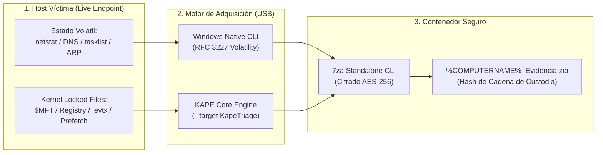

<div align="center">

# 🛡️ SOC-Bolsillo // Live Incident Response & Forensic Triage USB

<p align="center">
  <strong>Suite de Triage Forense y Respuesta a Incidentes (DFIR) 100% Automatizada y Desatendida</strong><br/>
  <em>Adquisición de evidencia volátil y artefactos críticos de disco (KAPE) con empaquetado seguro cifrado en AES-256.</em>
</p>

[](https://www.microsoft.com/)
[](https://www.kroll.com/)
[](https://www.7-zip.org/)
[](./Extraer_Evidencias.bat)
[](./docs/MITRE_ATTACK.md)
[](./LICENSE)

</div>

---

## ⚡ Ejecución Visual en Endpoint (Terminal Output)

```text
C:\USB_SOC> Extraer_Evidencias.bat
=== INICIANDO TRIAGE FORENSE 100% AUTOMATIZADO ===
[1/3] Recolectando evidencias volatiles (Red y Procesos)...
      -> netstat_conexiones.txt [OK - Sockets, PIDs y estados TCP/UDP]
      -> cache_dns.txt          [OK - Consultas recientes y registros C2]
      -> procesos_activos.txt   [OK - Tareas con privilegios y rutas]
      -> tabla_arp.txt          [OK - Mapeo de capa 2 y pasarelas LAN]

[2/3] Ejecutando KAPE (Artefactos de disco)...
      -> Target: KapeTriage (VSS / Raw Disk Access)
      -> Extrayendo: $MFT, Event Logs (.evtx), Registry Hives, Prefetch, Amcache, SRUM...
      -> Procesamiento completado en 184.2 segundos.

[3/3] Cifrando y comprimiendo evidencias (Password: SOC2026)...
      -> 7za.exe a -tzip -p"SOC2026" -mem=AES256 DESKTOP-IR01_Evidencia.zip
      -> Archivo generado: Evidencias\DESKTOP-IR01_Evidencia.zip (AES-256)

[!] Limpiando archivos temporales...
=== EXTRACCION COMPLETADA ===
La ventana se cerrara sola en 5 segundos...
```

---

## 🏗️ Arquitectura del Sistema



---

## 🚀 Capacidades de Ingeniería Forense

- **100% Desatendido (Zero-Touch Incident Response):** Diseñado para conectarse en una memoria USB y ejecutarse con doble clic. Cero pantallas de confirmación (`-y`), ejecución en modo silencioso (`--gui off`) y auto-cierre tras 5 segundos.
- **Cumplimiento estricto de RFC 3227:** Prioriza la captura de memoria y conexiones de red en vivo (sockets activos, caché DNS, procesos huérfanos) antes de interactuar con el subsistema de almacenamiento.
- **Acceso a Archivos Bloqueados vía KAPE:** Extracción a bajo nivel de artefactos del sistema bloqueados por el kernel (`$MFT`, hives de registro `SAM`, `SYSTEM`, `SOFTWARE`, `NTUSER.DAT` y logs de eventos de Windows `.evtx`).
- **Seguridad y Confidencialidad de la Evidencia (AES-256):** Toda la telemetría se comprime y cifra simétricamente con AES-256 mediante `7za.exe`. Si la memoria USB se pierde o es interceptada, la información del cliente/empresa permanece blindada.
- **Sanitización Automática de Temporales:** El script destruye los datos en texto claro inmediatamente tras verificar el empaquetado comprimido, minimizando la huella del triage en el host analizado.
- **Auditoría y Cadena de Custodia Formal:** Incluye [`Generar_Hash_Custodia.ps1`](./Generar_Hash_Custodia.ps1) para calcular hashes SHA-256 / SHA-1 y documentar el caso forense.

---

## 🛠️ Estructura del Repositorio

```text
SOC-Bolsillo/
├── Extraer_Evidencias.bat      # Script principal de triage automatizado y desatendido
├── Preparar_USB.ps1            # Script de aprovisionamiento, descarga de 7za y auditoría USB
├── Generar_Hash_Custodia.ps1   # Generador de firmas SHA-256 / SHA-1 para cadena de custodia
├── Herramientas/
│   ├── README.md               # Documentación y parámetros del binario 7za.exe
│   └── 7za.exe                 # Compresor standalone 7-Zip con soporte AES-256
├── KAPE/
│   ├── README.md               # Guía de targets, módulos y descarga de Kroll KAPE
│   └── kape.exe                # Motor KAPE (suministrado por el operador según licencia Kroll)
├── Evidencias/
│   └── .gitkeep                # Directorio donde se almacenan los paquetes cifrados
├── docs/
│   ├── ARQUITECTURA.md         # Desglose en profundidad del orden de volatilidad y fases
│   └── MITRE_ATTACK.md         # Mapeo exhaustivo de artefactos vs técnicas MITRE ATT&CK
├── .gitignore                  # Exclusión estricta de binarios, dumps y volcados reales
├── LICENSE                     # Licencia de código abierto MIT
└── README.md                   # Documentación técnica principal
```

---

## ⏱️ Puesta en Marcha en 60 Segundos

### Paso 1: Clonar y Preparar el Pendrive USB

Conecta una unidad USB (recomendado sistema de archivos **NTFS** o **exFAT**):

```powershell
# Clonar el repositorio dentro de tu memoria USB (ej. Unidad E:)
git clone https://github.com/Kekkan74/SOC-Bolsillo.git E:\SOC-Bolsillo
cd E:\SOC-Bolsillo

# Ejecutar el aprovisionador automático (descarga 7za.exe y valida carpetas)
powershell -ExecutionPolicy Bypass -File .\Preparar_USB.ps1
```

### Paso 2: Colocar KAPE

Descarga KAPE desde el [portal oficial de Kroll](https://www.kroll.com/en/services/cyber-risk/incident-response-litigation-support/kroll-artifact-parser-extractor-kape) y descomprímelo dentro de la carpeta `KAPE\`.

### Paso 3: Ejecución en el Endpoint Sospechoso

1. Inserta el pendrive en la máquina Windows bajo sospecha.
2. Abre la consola o ejecuta como Administrador:
   ```cmd
   E:\SOC-Bolsillo\Extraer_Evidencias.bat
   ```
3. El script recopilará los artefactos y generará el archivo:
   `E:\SOC-Bolsillo\Evidencias\%COMPUTERNAME%_Evidencia.zip`

### Paso 4: Generar Registro de Cadena de Custodia

Desde la estación de análisis del analista SOC:
```powershell
powershell -ExecutionPolicy Bypass -File .\Generar_Hash_Custodia.ps1 -Analista "Kekkan74" -CasoID "INC-2026-0042"
```

El script registrará los hashes SHA-256 y SHA-1 en `Evidencias\Cadena_Custodia.txt`.

---

## ⚖️ Decisiones de Diseño e Ingeniería (ADR)

| Decisión Técnica | Enfoque Implementado | Alternativa Considerada | Justificación de Ingeniería |
| :--- | :--- | :--- | :--- |
| **Lenguaje del Script** | **Batch (`.bat`) nativo** | Script PowerShell (`.ps1`) | Elimina dependencias de `ExecutionPolicy` restringidas en entornos corporativos de Windows y arranca instantáneamente sin dependencias de runtime. |
| **Mecanismo de Compresión** | **`7za.exe` CLI Standalone** | `Compress-Archive` nativo de PowerShell | `Compress-Archive` no soporta cifrado de contraseñas AES-256 nativo y bloquea la memoria en archivos mayores a 2 GB. `7za.exe` es ultra liviano (~1 MB) y portable. |
| **Adquisición de Disco** | **KAPE (`KapeTriage`)** | Clonado completo de disco (`dd` / FTK Imager) | Una imagen física completa tarda horas y ocupa terabytes. KAPE extrae en <5 minutos el 99% de los artefactos necesarios para la detección de amenazas. |
| **Almacenamiento Cifrado** | **Contenedor `.zip` con clave AES-256** | Contenedores BitLocker To Go | El archivo ZIP cifrado en AES-256 puede abrirse e ingestarse directamente en estaciones forenses Linux (SANS SIFT, CAINE) o Windows sin llaves TPM. |

---

## 🎯 Cobertura MITRE ATT&CK

El conjunto de artefactos recolectados cubre las principales técnicas de intrusión:

- **T1049 & T1016 (Network & Connections Discovery):** Mapeo de sockets y conexiones C2 activas.
- **T1057 (Process Discovery):** Detección de procesos inyectados o malware en ejecución.
- **T1059 (Command & Scripting):** Historial en logs de eventos (`4688`, `4104`).
- **T1547 & T1053 (Persistence):** Llaves de registro Run/RunOnce y tareas programadas.
- **T1070 (Defense Evasion):** Detección de vaciado de registros (`Event ID 1102 / 104`).

Consulta la documentación completa en [docs/MITRE_ATTACK.md](./docs/MITRE_ATTACK.md).

---

## ⚠️ Consideraciones Forenses y OPSEC

1. **Uso de Bloqueadores de Escritura (Hardware Write Blockers):** Para investigaciones judiciales estrictas, la unidad USB debe contar con conmutador físico de protección contra escritura o ejecutarse minimizando escrituras en el disco origen.
2. **Sistema de Archivos del USB:** Se recomienda encarecidamente formatear la unidad USB en **NTFS** o **exFAT**. Los sistemas formateados en FAT32 fallarán si el archivo final de evidencia excede el límite de 4 GB.
3. **Contraseña por Defecto:** La contraseña configurada por defecto es `SOC2026`. Se recomienda modificarla en el script antes de desplegar en producción.

---

## 📄 Licencia

Este proyecto está distribuido bajo la licencia [MIT](./LICENSE). KAPE es propiedad intelectual de Kroll / Eric Zimmerman. 7-Zip es desarrollado por Igor Pavlov bajo licencia GNU LGPL.
