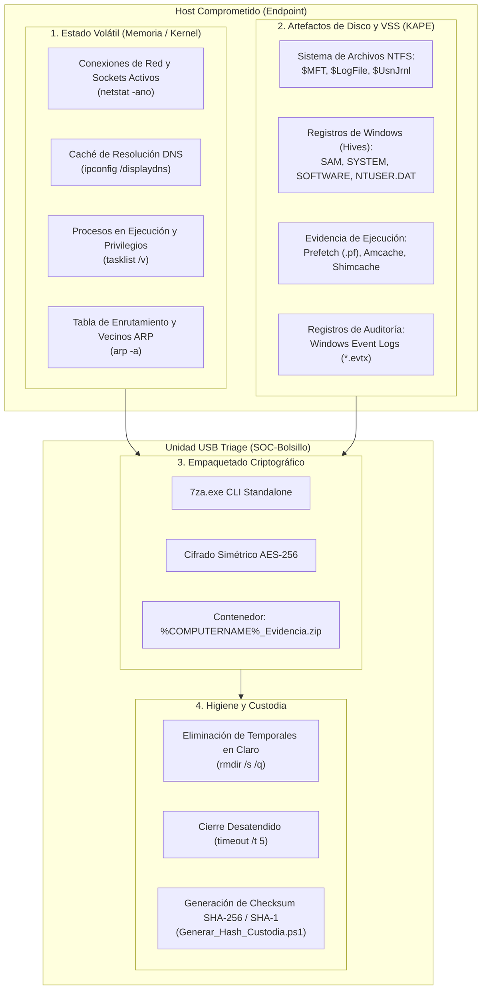

# Arquitectura Técnica & Pipeline Forense // SOC-Bolsillo

## 1. Orden de Volatilidad (RFC 3227)

En la respuesta a incidentes cibernéticos (DFIR), el principio fundamental es el **Orden de Volatilidad** estipulado en el **RFC 3227**: *los datos más efímeros y susceptibles de desaparecer tras un reinicio o apagado deben ser recolectados en primer lugar*.



---

## 2. Desglose Fase por Fase

### Fase 1: Evidencia Volátil (Live Response Triage)
Se ejecuta de forma prioritaria para congelar el estado de red y memoria del host antes de que conexiones C2 (Command & Control) expiren o procesos maliciosos finalicen.

| Artefacto / Comando | Archivo de Salida | Valor Forense |
| :--- | :--- | :--- |
| `netstat -ano` | `netstat_conexiones.txt` | Identifica IPs/puertos remotos de beacons activos, puertos en escucha (`LISTENING`) y PIDs asociados para mapear a procesos específicos. |
| `ipconfig /displaydns` | `cache_dns.txt` | Revela dominios maliciosos (DGA, typosquatting, C2) consultados recientemente por malware, incluso si la conexión TCP ya se cerró. |
| `tasklist /v` | `procesos_activos.txt` | Muestra ejecutables activos, memoria consumida, nombres de usuario propietarios (detección de escalada a `NT AUTHORITY\SYSTEM`) y títulos de ventana. |
| `arp -a` | `tabla_arp.txt` | Detecta ataques de spoofing ARP en la LAN, gateways maliciosos o dispositivos adyacentes involucrados en movimiento lateral. |

---

### Fase 2: Artefactos de Disco de Alto Impacto (KAPE)
El script invoca **KAPE** con el target compuesto `KapeTriage`:
```cmd
%~dp0KAPE\kape.exe --tsource C: --target KapeTriage --tdest "%EVIDENCIAS%\Kape" --tflush --gui off
```
- **Bypass de Bloqueos de Archivos:** El kernel de Windows impide copiar archivos críticos como `C:\Windows\System32\config\SYSTEM` o `$MFT` con utilidades convencionales (`xcopy`, `robocopy`). KAPE utiliza controladores de bajo nivel para leer bloques directos de la partición NTFS o Volume Shadow Copies (VSS).
- **Alcance Quirúrgico:** En lugar de clonar cientos de gigabytes de archivos de usuario o binarios del sistema limpios, KAPE extrae en menos de 5 minutos únicamente la metadata forense necesaria para reconstruir la línea de tiempo del atacante.

---

### Fase 3: Cifrado AES-256 y Sanitización de Evidencia
Una vez finalizada la extracción:
```cmd
%~dp0Herramientas\7za.exe a -tzip -p"SOC2026" -mem=AES256 "%~dp0Evidencias\%COMPUTERNAME%_Evidencia.zip" "%EVIDENCIAS%" -y >nul
rmdir /s /q "%EVIDENCIAS%"
```
1. **Confidencialidad de la Evidencia (Data-at-Rest Protection):** Las evidencias forenses contienen contraseñas en memoria (SAM/LSASS dumps potenciales), historial de navegación, logs de usuarios y datos corporativos sensibles. El cifrado AES-256 previene la fuga de información si la unidad USB se extravía o es confiscada.
2. **Higiene Operativa:** La carpeta temporal que contenía los archivos en texto claro se destruye inmediatamente tras completar la compresión cifrada.
3. **Ejecución 100% Desatendida:** Parámetros como `-y` (yes to all prompts), `>nul` (silenciamiento de salida ruidosa) y `timeout /t 5 >nul` garantizan que el operador no tenga que interactuar con el teclado una vez lanzado el script.
